# CovSpot Thesis -- Figure Compilation

Compiled inventory of the 14 figures generated by `thesis_figures.Rmd`. Each
entry below lists the source data, what the figure shows, the headline
takeaway from the current run, and a short suggested caption for thesis use.

All figures are saved at 300 dpi in `figs/`. Re-rendering: knit
`thesis_figures.Rmd` (or `Rscript -e 'rmarkdown::render(...)'`).

---

## Figure 1 -- Cross-method performance grid

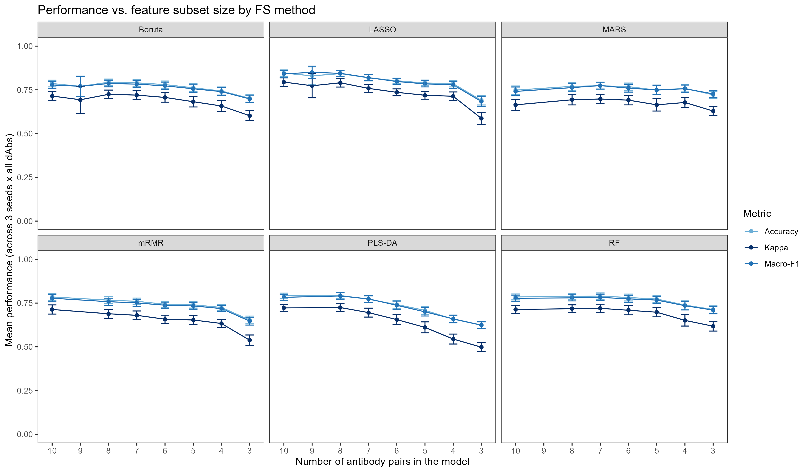

**Source.** `final_test_results` slot from each method's multiseed `.rds`,
stacked across (3 seeds x 13 dAbs).
**What it shows.** Mean test accuracy, kappa, and macro-F1 vs. number of
selected antibody pairs. One panel per FS method; +/-1 SE error bars
aggregate over (seed x dAb).
**Takeaway.** All six methods plateau between roughly 6 and 10 features and
degrade below 5. PLS-DA loses the most performance moving from 10 to 3 pairs
(accuracy ~0.78 -> ~0.62, kappa ~0.70 -> ~0.50); Boruta and RF stay flattest,
suggesting their selections are more redundant than LASSO's.
**Caption (draft).** *Performance of the multinomial classifier as a function
of the number of antibody pairs, by feature-selection method. Points are means
across three random seeds and all 13 detection antibodies; error bars are
standard errors. The 5-6 pair regime is where every method begins to lose
classifier kappa, defining the engineering sweet spot for device deployment.*

---

## Figure 2 -- Method x dAb test-accuracy heatmap

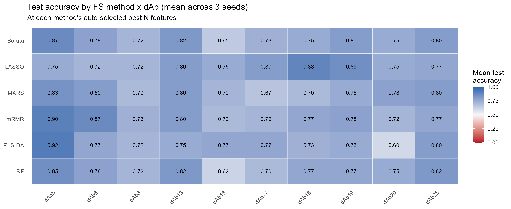

**Source.** `test_metrics$accuracy` per (method x seed x dAb), averaged
over seeds.
**What it shows.** Each method's mean test-set accuracy on every dAb at the
auto-selected best feature count.
**Takeaway.** dAb5 is universally easy (0.83-0.92). dAb16 is the most
method-dependent dAb -- LASSO 0.75 vs RF 0.62, a 13-point spread -- which
the confusion matrices in Fig. 4 attribute to a Delta -> Beta collapse under
RF. dAb18 is LASSO's standout (0.88) and a strong runner-up under most
other methods.
**Caption (draft).** *Mean test accuracy across three seeds for every
combination of feature-selection method and detection antibody at each
method's auto-selected number of features. The heatmap exposes both
universally informative dAbs (dAb5, dAb13) and dAbs whose accuracy is highly
contingent on the feature-selection algorithm (dAb16).*

---

## Figure 3 -- Selection frequency of cAb partners by dAb

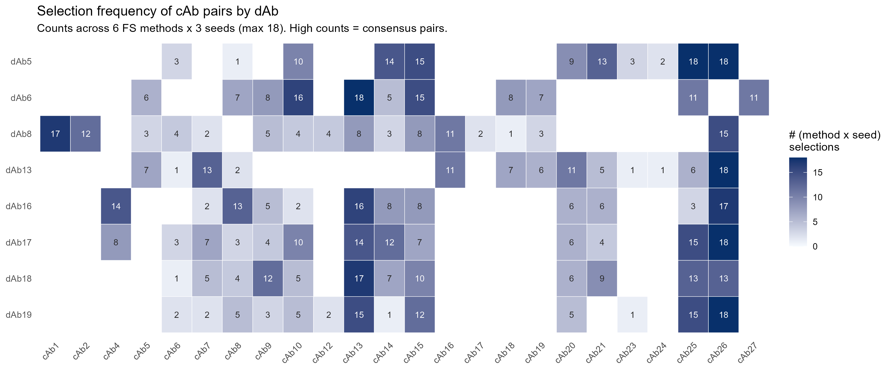

**Source.** `run_summary$best_features` collected across (6 methods x 3
seeds) -- each cell counts how many of the 18 runs put that pair into the
final model.
**What it shows.** Consensus picks vs. method-/seed-idiosyncratic picks for
each top dAb.
**Takeaway.** cAb25 and cAb26 are near-universal partners (counts of 13-18
across most top dAbs). cAb13/cAb14/cAb15 form a secondary consensus cluster.
dAb8's top partner is cAb1 (17/18) -- unusual relative to the rest. Pairs
with single-digit counts are method-specific noise and should not anchor
the final assay design.
**Caption (draft).** *Selection frequency of capture antibodies (cAbs) within
each detection antibody's (dAb's) best-feature set across all 18 (method x
seed) feature-selection runs. cAb25 and cAb26 emerge as the most
consistently selected partners across dAbs.*

---

## Figure 4 -- RF confusion matrices for top dAbs

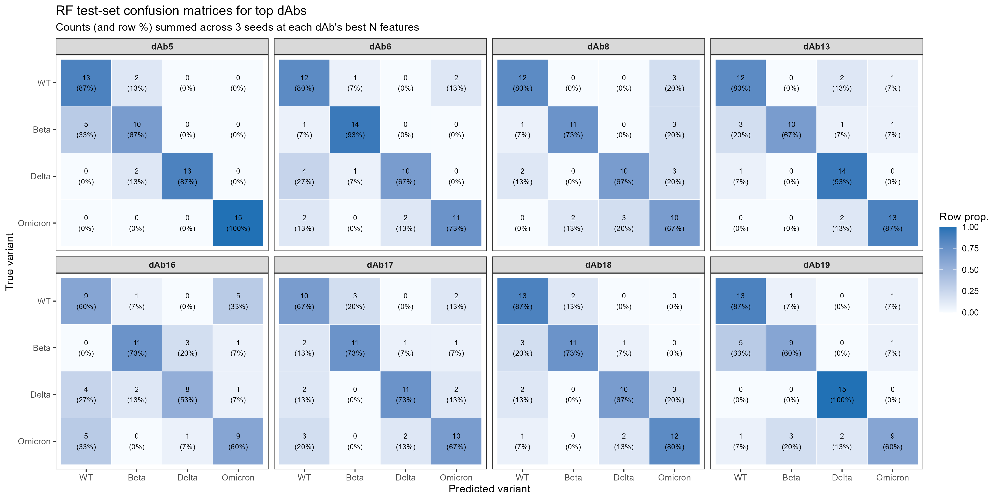

**Source.** `test_conf_mat` summed across 3 seeds, RF runs only.
**What it shows.** Counts and row-proportions of true-vs-predicted variant
calls on the held-out final test set, faceted by dAb.
**Takeaway.** dAb5, dAb6, dAb13, dAb18 are nearly diagonal (>=80% recall on
all four variants). dAb16's accuracy gap (Fig. 2) is a Delta misclassification
-- 8/15 Delta samples get called Beta. dAb19 has perfect Delta recall (15/15)
but fragmented WT performance (5/15 Beta).
**Caption (draft).** *Random-forest confusion matrices for the eight top
detection antibodies on held-out test data, with counts summed across three
seeds (each cell shows raw count and row percentage). Off-diagonal mass
identifies which variant pairs each dAb confuses; dAb16 fails primarily by
collapsing Delta into Beta, while dAb13 and dAb18 are nearly diagonal.*

---

## Figure 5 -- Per-variant precision / recall / F1 (RF)

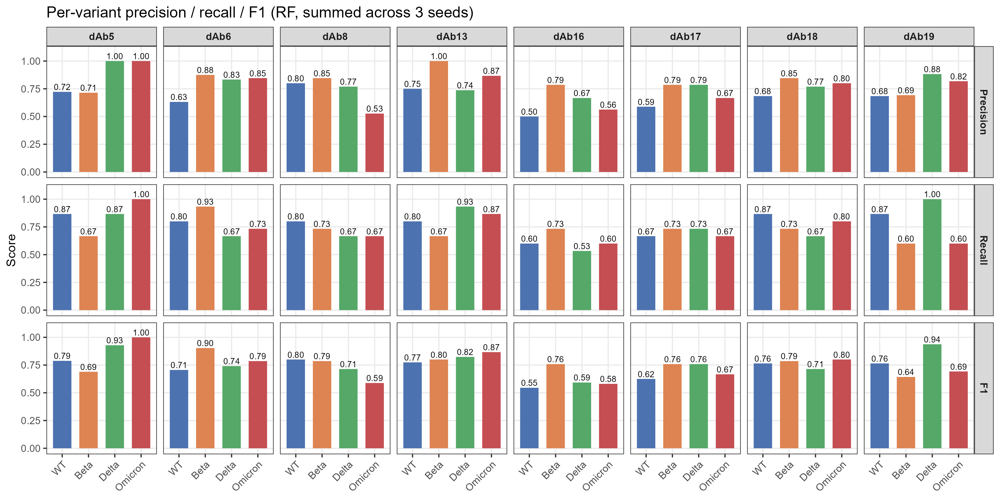

**Source.** Derived from the summed confusion matrices in Fig. 4.
**What it shows.** Variant-level precision, recall, and F1 for each top
dAb, breaking the macro-averaged numbers in Fig. 2 down by class.
**Takeaway.** Macro accuracy hides class-specific failures: dAb16 has
Delta F1 = 0.55 even though its overall accuracy is 0.62. dAb13 has perfect
Delta recall (1.00) but only 0.79 precision because Beta and Omicron leak
into the Delta column. WT and Omicron are the easiest classes overall.
**Caption (draft).** *Per-variant precision, recall, and F1 derived from the
random-forest confusion matrices in Fig. 4. The per-class view exposes
asymmetric failure modes that the aggregated accuracy in Fig. 2 obscures.*

---

## Figure 6 -- Dose-response curves for top-LASSO partners

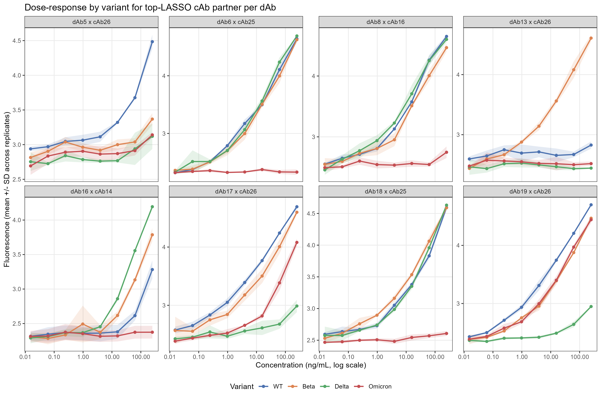

**Source.** `screen_long` (long-form raw data) restricted to the top-1
LASSO-importance cAb partner per top dAb. Mean +/- SD across the 3
replicates at each concentration.
**What it shows.** Fluorescence vs. concentration on a log10 axis, colored
by variant, faceted by (dAb, cAb) pair.
**Takeaway.** Most top pairs separate WT/Beta/Delta from Omicron at high
concentrations; for several pairs (dAb6_cAb25, dAb17_cAb26, dAb18_cAb25) the
variants only fan out above ~10 ng/mL, which sets a lower bound on the
useful clinical concentration range. dAb13_cAb26 is a striking exception --
Beta separates from the other three across the full concentration range,
explaining its appearance as a strong single-variant detector.
**Caption (draft).** *Mean fluorescence (+/- SD across three replicates) as a
function of analyte concentration for each detection antibody's top
LASSO-ranked capture-antibody partner. Curves are colored by variant.
Dose-response separability above ~10 ng/mL drives most of the
classification signal.*

---

## Figure 7 -- Replicate reproducibility ranking

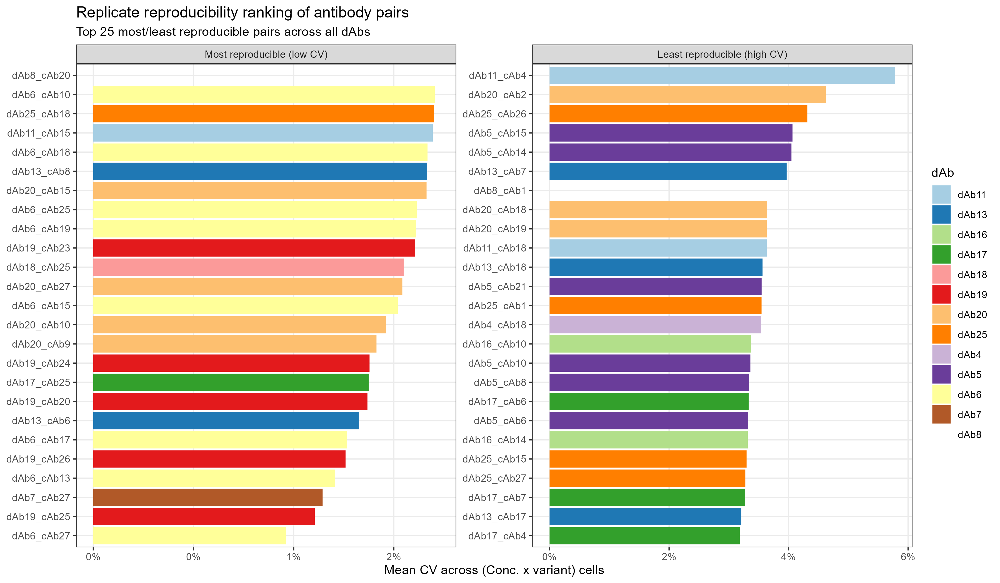

**Source.** Coefficient of variation (sd/mean) computed across the 3
replicates at each (concentration x variant) cell, then averaged per pair.
**What it shows.** The 25 most reproducible (lowest mean CV) and 25 least
reproducible pairs across the entire screen.
**Takeaway.** All pairs sit below 6% CV -- the assay is reproducible at the
replicate level. The most reproducible pairs (dAb8_cAb20, dAb6_cAb10,
dAb25_cAb18 at ~1%) are not the same pairs as the most-classifying pairs in
Figs. 3 and 12, which is expected -- low CV measures consistency, not
discriminative power. Worth flagging dAb16 and dAb5 contributing several
high-CV pairs (e.g., dAb16_cAb14, dAb5_cAb15) given their roles in the
final models.
**Caption (draft).** *Coefficient of variation across triplicate replicates,
averaged across all (concentration x variant) cells, for the 25 most and 25
least reproducible antibody pairs in the screen. All pairs measured below 6%
CV, supporting the choice to use raw (non-bagged) replicate readings as
model input.*

---

## Figure 8 -- PCA of all 29 cAb columns per top dAb

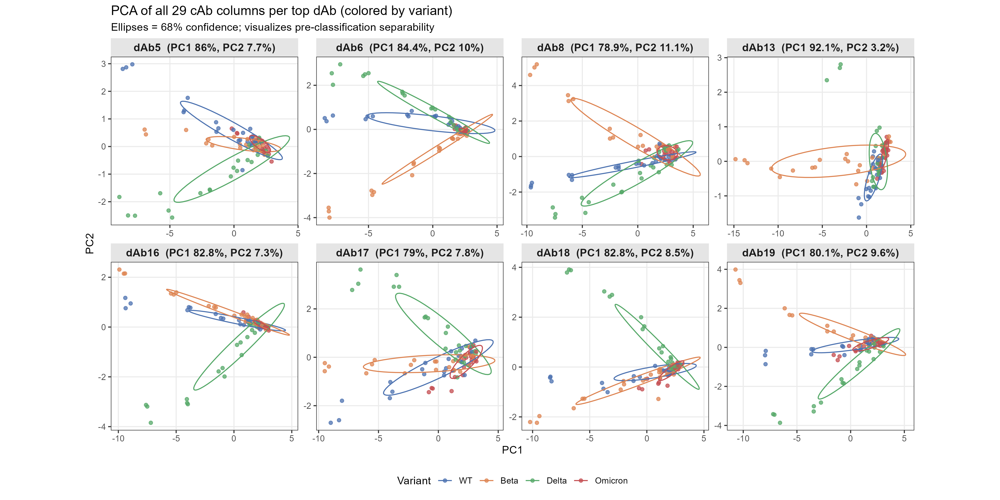

**Source.** `prcomp(scale = TRUE)` applied to each top dAb's 29-column
fluorescence matrix (all replicates and concentrations stacked).
**What it shows.** First two principal components colored by variant, with
68% confidence ellipses. Variance explained per panel printed in the strip.
**Takeaway.** dAb5, dAb13, dAb16, dAb17, dAb18, and dAb19 have PC1 explaining
>=80% of the variance -- the dominant axis is concentration, with variants
sorted along it. dAb6 and dAb8 are flatter (PC1 ~84%/79%) and show clearer
two-dimensional variant separation. The PCA confirms that variant identity
is recoverable from the raw 29-column readouts before any feature selection.
**Caption (draft).** *Principal-component projections of the full 29-column
capture-antibody fluorescence matrix for each top detection antibody,
colored by SARS-CoV-2 variant; ellipses denote 68% confidence regions.
Variant clusters are visible in PC1-PC2 space prior to any supervised
feature selection.*

---

## Figure 9 -- Augmented vs. original distributions (dAb16)

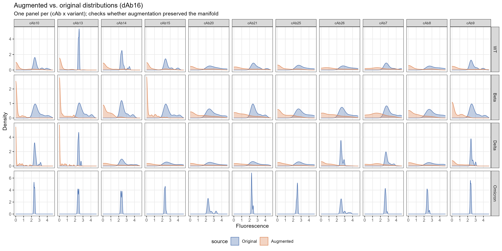

**Source.** `Embedded_FS/covspot_data_aug_1_processed.csv` overlaid against
the matching subset of the original screen. The augmented file maps onto
dAb16 (11 overlapping cAbs).
**What it shows.** Density of fluorescence values per (cAb x variant) cell;
original in blue, augmented in orange.
**Takeaway.** The augmentation generally preserves the modal signal (the
peaks coincide for most cells) but introduces a much heavier left tail and a
visibly wider distribution. Beta and Delta panels are most distorted -- the
augmentation has shifted mass toward zero, which may inflate apparent
class-level variance without improving classifier robustness. Worth
re-examining the augmentation procedure before relying on it for Phase 2
validation.
**Caption (draft).** *Density of fluorescence readings for each (capture
antibody x variant) cell of detection antibody dAb16. Distributions from the
original screen (blue) and augmented dataset (orange) are overlaid; the
augmented data preserves modal values but introduces a heavy low-fluorescence
tail not seen in the original screen.*

---

## Figure 10 -- RF one-vs-rest ROC curves per top dAb

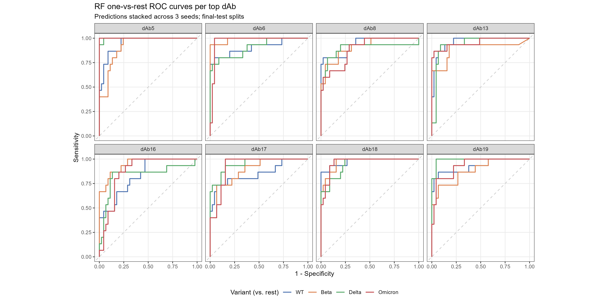

**Source.** Each `final_fit` re-augmented on its stored `final_split`
test partition, predicted probabilities stacked across the 3 seeds, then
yardstick `roc_curve` per variant treated as the positive class.
**What it shows.** ROC curves (sensitivity vs. 1 - specificity) for each
variant, faceted by dAb.
**Takeaway.** dAb5, dAb13, and dAb18 have curves clustered in the top-left
corner -- effectively perfect discrimination. dAb16 ROC curves are
visibly looser, consistent with its poorer accuracy and Delta confusion in
Figs. 2 and 4. Omicron is the easiest variant to discriminate across all
top dAbs.
**Caption (draft).** *One-vs-rest receiver-operating characteristic curves
for the random-forest models on each top detection antibody. Predictions
are stacked across three seeds on each model's held-out final-test split.
Curves cluster near the top-left corner for dAb5, dAb13, and dAb18,
indicating near-perfect discrimination at deployable feature counts.*

---

## Figure 11 -- RF probability calibration per variant

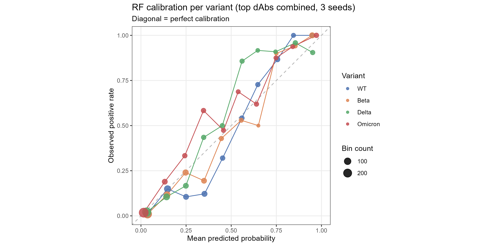

**Source.** Same stacked RF probability predictions as Fig. 10, binned in
0.1 increments and averaged per variant.
**What it shows.** Mean predicted probability vs. observed positive rate
per bin, by variant; perfectly calibrated lies on the diagonal.
**Takeaway.** WT is consistently *under-confident* (points above the
diagonal) -- the model could be trusted to be more aggressive on WT. Beta is
*over-confident* in the 0.2-0.4 range. Delta and Omicron are roughly
calibrated. If downstream device logic uses RF probabilities for confidence
intervals, a per-class temperature scaling or isotonic recalibration would
materially help WT/Beta.
**Caption (draft).** *Probability calibration of the random-forest classifier
across top detection antibodies, stratified by variant. Each point is a
probability-decile bin; point size is bin sample size; the dashed diagonal
denotes perfect calibration. WT predictions are systematically
under-confident and Beta predictions over-confident in the mid-probability
range.*

---

## Figure 12 -- LASSO pair importance per top dAb

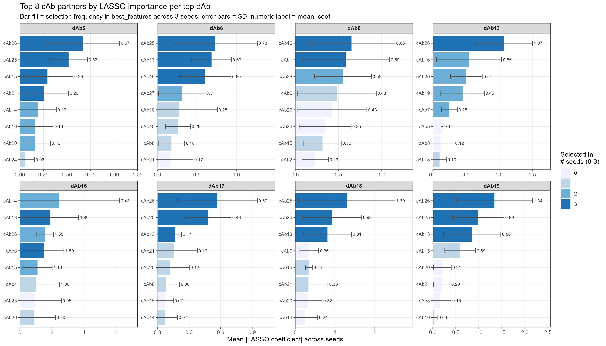

**Source.** `feature_ranking$importance` (mean absolute coefficient across
variant classes) averaged across 3 seeds, top 8 cAbs per top dAb.
**What it shows.** Bar = mean importance, error bar = SD across seeds, fill
shade = how many of 3 seeds picked this pair into the final
best-feature set.
**Takeaway.** dAb16_cAb14 dominates LASSO (mean |coef| = 2.43) -- the only
pair above 2.0. dAb18_cAb25 (1.30), dAb19_cAb26 (1.34), and dAb13_cAb26
(1.07) are the next strongest single contributors. Selection-frequency
shading reveals stable cores: dAb18's top three (cAb25, cAb6, cAb13) all
appear in 3/3 seeds, while dAb19's pattern is more diffuse with several
2/3 selections. dAb17 has notably small absolute coefficients across the
board, suggesting LASSO finds many weakly informative partners rather
than a few strong ones.
**Caption (draft).** *Top eight capture antibodies per detection antibody
ranked by mean absolute LASSO coefficient across three seeds. Bar shading
indicates the number of seeds in which each pair was retained in the
selected best-feature set; error bars are standard deviations of mean
importance across seeds.*

---

## Figure 13 -- Per-variant fluorescence beeswarms (top dAbs)

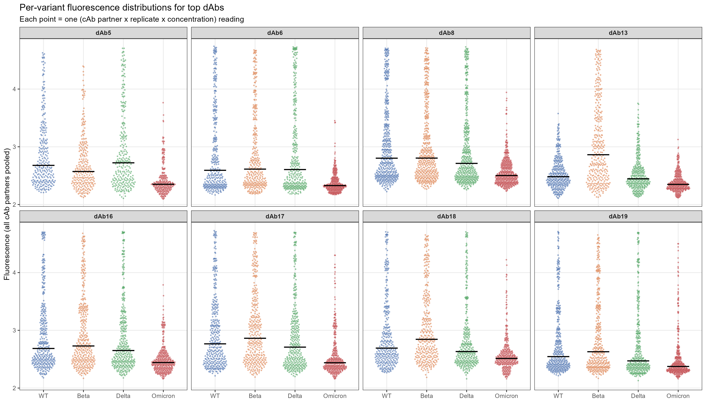

**Source.** `screen_long` filtered to top dAbs, all (cAb partner x
replicate x concentration) readings pooled per (dAb x variant).
**What it shows.** Pooled fluorescence distribution per variant for each
top dAb, with median crossbars overlaid.
**Takeaway.** Most top dAbs show a clear ordering (Delta > Beta ~ WT >
Omicron) at the median level. dAb16 has the smallest cross-variant median
spread, again consistent with its poorer downstream classification accuracy.
The pooled view is useful for thesis intro material but obscures the
concentration-dependence captured in Fig. 6.
**Caption (draft).** *Per-variant fluorescence distributions for the eight
detection antibodies that drive the final classifier, with all capture
antibody partners, replicates, and concentrations pooled. Black crossbars
mark per-variant medians; the spread of medians by dAb foreshadows
classification difficulty in Figs. 2 and 4.*

---

## Figure 14 -- Compiled performance summary (patchwork)

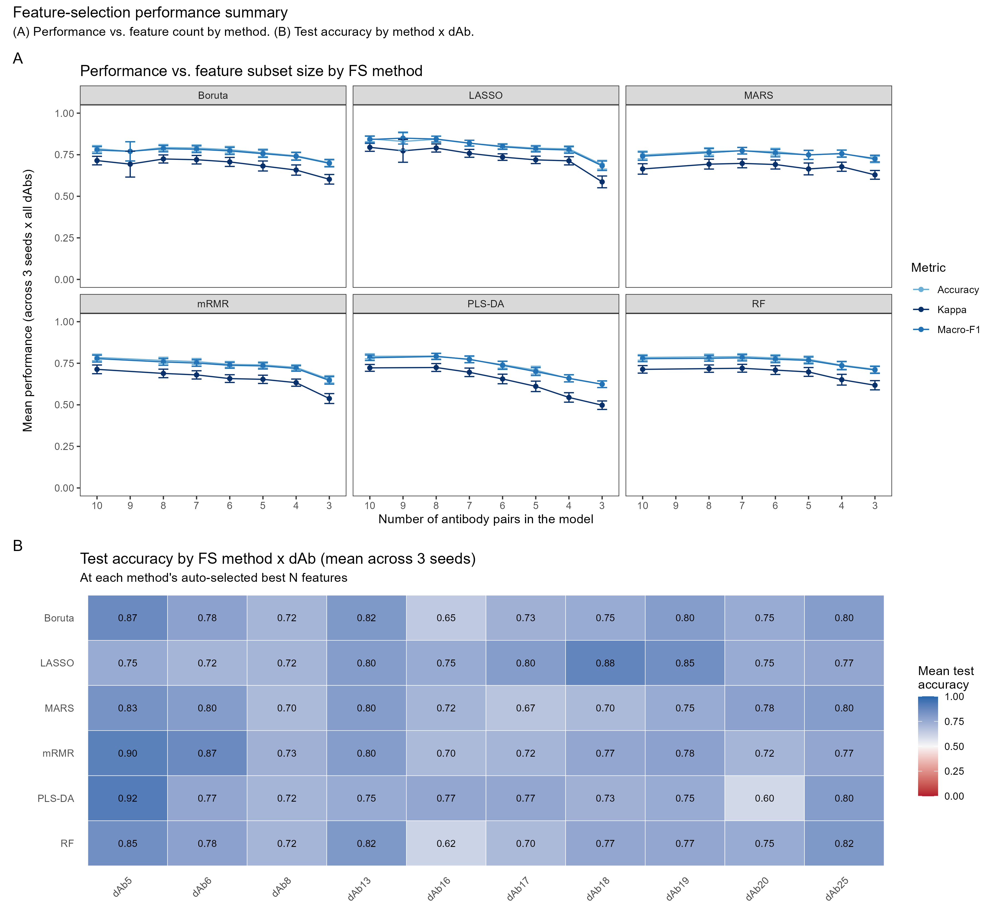

**Source.** Composite of Figs. 1 and 2 stacked with `patchwork`.
**What it shows.** Two-panel summary: (A) performance vs. feature count by
method; (B) test accuracy by method x dAb. Designed as the single chapter
opener.
**Takeaway.** Reading A then B answers the two top-level questions
together: "How few pairs can the device get away with?" (5-6, regardless of
method) and "Which dAbs deliver?" (dAb5, dAb13, dAb18, dAb19).
**Caption (draft).** *Summary of feature-selection results across all six
methods. (A) Performance vs. number of selected pairs; (B) per-detection
antibody test accuracy at each method's auto-selected best feature count.
Together they identify both the engineering sweet spot (5-6 pairs) and the
detection antibodies that drive classification quality.*

---

## Master story arc (suggested ordering for the thesis chapter)

1. Fig. 13 (or 6) -- raw screen, what the data looks like.
2. Fig. 8 -- variant identity is already recoverable in unsupervised PCA.
3. Fig. 7 -- the assay is reproducible at the replicate level.
4. Fig. 14 (= 1 + 2) -- chapter-level performance summary.
5. Fig. 3 + Fig. 12 -- which pairs the algorithms agree on.
6. Fig. 4 + Fig. 5 -- where the models still fail (per-variant).
7. Fig. 10 + Fig. 11 -- discrimination quality and calibration.
8. Fig. 9 -- caveats around augmentation (frames Phase 2 future work).
