Phase 1: pure tidymodels refactor of `Embedded_FS/augmented_data_modeling_v2.Rmd`.
Phase 2 (separate chunk at the bottom, currently a placeholder) will add a
Bayesian update on top: original data → posterior → use as prior when refitting
on the augmented batch, modelling the in-field feedback loop.

```{r setup, include = FALSE}
library(tidymodels)
library(themis)      # step_smote (multi-class safe; replaces broken step_rose)
library(ranger)
library(ggplot2)

set.seed(2024)
```

# Load and basic cleaning

`combined_augment_with_batch.csv` is the merged batch-1 + batch-2 augmented
panel (744 rows, 11 cAbs). `cAb13` is removed because this dAb panel was built
*around* dAb13 — its self-pair is excluded from the predictor space, matching
the convention in v2.

```{r load}
raw = read.csv("combined_augment_with_batch.csv") |>
  as_tibble() |>
  mutate(
    target_vector = factor(target_vector),
    batch         = factor(batch)
  ) |>
  select(-cAb13)

raw
```

# Helper: total-fluorescence normalization

In v2 this was done as an upfront mutate with hardcoded row indices (a real
bug — see [augmented_data_modeling_v2.Rmd:35](../Embedded_FS/augmented_data_modeling_v2.Rmd#L35)).
Reframing as a row-wise transform makes it leakage-safe (it only uses within-row
information, so it's fine to apply pre-split or as a `step_mutate` inside a
recipe).

```{r total_norm}
total_normalize = function(df) {
  cab_cols = grep("^cAb", names(df), value = TRUE)
  totals = rowSums(df[cab_cols], na.rm = TRUE)
  keep   = totals > 0 & is.finite(totals)
  df[keep, cab_cols] = df[keep, cab_cols] / totals[keep]
  df[keep, , drop = FALSE] |>
    mutate(total_fluor = totals[keep],
           avg_fluor   = totals[keep] / length(cab_cols))
}

# Optional: produce a normalized variant for visualization / sanity checks
norm_data = total_normalize(raw)
```

# DR visualisation (fixed)

Original v2 version used `mutate(across(Conc., round, 3))` (deprecated dplyr 1.1
form) and pulled `Replicate` out of a `select(-c(Replicate))` even when not
present. Cleaned up below.

```{r dr_viz}
dr_viz = function(dataset) {
  std_err = function(x) sd(x, na.rm = TRUE) / sqrt(sum(!is.na(x)))

  dataset |>
    select(-any_of(c("Replicate", "batch", "total_fluor", "avg_fluor"))) |>
    pivot_longer(
      cols      = -c(target_vector, Conc.),
      names_to  = "pair",
      values_to = "fluorescence"
    ) |>
    group_by(Conc., target_vector, pair) |>
    summarise(
      mean_fluor = mean(fluorescence, na.rm = TRUE),
      se         = std_err(fluorescence),
      .groups    = "drop"
    ) |>
    ggplot(aes(Conc., mean_fluor, color = target_vector)) +
    geom_point() +
    geom_line() +
    geom_errorbar(aes(ymin = mean_fluor - se, ymax = mean_fluor + se), width = 0.2) +
    facet_wrap(~ pair, scales = "free_y") +
    scale_x_log10() +
    theme_minimal()
}

dr_viz(raw)
dr_viz(norm_data)
```

# UMAP (single definition, fixed)

v2 had two `umap_viz` functions, the second overwriting the first. The second
one called `grid_latin_hypercube(neighbors(), min_dist())` without a `size`
argument, which errors. Below is one canonical version with no broken grid call.

```{r umap_viz}
umap_viz = function(dataset, neighbors = 15, min_dist = 0.05, seed = 2024) {
  set.seed(seed)

  d = dataset |>
    select(-any_of(c("Replicate", "batch", "total_fluor", "avg_fluor"))) |>
    mutate(Conc. = round(Conc., 3))

  rec = recipe(~ ., data = d) |>
    update_role(Conc., target_vector, new_role = "id") |>
    step_zv(all_predictors()) |>
    step_normalize(all_predictors()) |>
    step_umap(all_predictors(), num_comp = 2,
              neighbors = neighbors, min_dist = min_dist) |>
    prep()

  juice(rec) |>
    ggplot(aes(UMAP1, UMAP2, color = target_vector, label = Conc.)) +
    geom_point(alpha = 0.7, size = 2) +
    geom_text(check_overlap = TRUE, hjust = "inward") +
    theme_minimal() +
    labs(color = NULL)
}

umap_viz(raw |> filter(Conc. > 0.1, Conc. < 249))
umap_viz(norm_data |> filter(Conc. > 0.1, Conc. < 249))
```

# Modeling pipeline

Single deployable RF model trained on the combined augmented data. Mirrors the
recipe + workflow + tune pattern from `Embedded_FS/rf_tidymodels.R` but without
the three-level FS split — this script is downstream of FS, evaluating the
*deployment* model.

Notes on what's included as a predictor:

- `Conc.` is **dropped**: variant identity should not depend on analyte
  concentration (matches FS pipeline convention).
- `batch` is **dropped from predictors** but used to stratify the split so train
  and test see both batches. Including batch as a predictor would let the model
  memorize the batch label, which won't generalize to a third batch in the field.
- `Replicate` is **dropped**: row-level id, no signal.

```{r split}
conc_threshold = 0.9  # lower bound on Conc.; rows at or below are excluded
# Filter is applied before splitting so train, CV folds, and the held-out test
# never see sub-threshold rows — low-conc noise cannot influence training.

clean = raw |>
  filter(Conc. > conc_threshold) |>
  select(-Replicate)

# Stratify on target × batch so each split sees both batches across all variants
clean = clean |> mutate(strata = interaction(target_vector, batch, drop = TRUE))

split    = initial_split(clean, prop = 0.8, strata = strata)
train_df = training(split) |> select(-strata)
test_df  = testing(split)  |> select(-strata)
```

```{r recipe}
rf_recipe = recipe(target_vector ~ ., data = train_df) |>
  step_rm(Conc., batch) |>
  step_zv(all_numeric_predictors()) |>
  step_impute_knn(all_numeric_predictors(), neighbors = 3) |>
  step_smote(target_vector, over_ratio = 1, skip = TRUE)
```

```{r model_spec}
rf_spec = rand_forest(mtry = tune(), min_n = tune(), trees = 500) |>
  set_engine("ranger", importance = "permutation", seed = 2024) |>
  set_mode("classification")

rf_wf = workflow() |>
  add_recipe(rf_recipe) |>
  add_model(rf_spec)
```

```{r tune, message = FALSE, warning = FALSE}
folds = vfold_cv(train_df, v = 5, strata = target_vector)

p_pred = ncol(train_df) - 3L  # subtract target_vector, Conc., batch
mtry_values = sort(unique(pmax(1L, c(2L, floor(sqrt(p_pred)),
                                     floor(p_pred / 3L), floor(p_pred / 2L)))))

rf_grid = expand.grid(
  mtry  = mtry_values,
  min_n = c(2, 5, 10)
)

cv_metrics = metric_set(accuracy, kap, f_meas)

tune_res = tune_grid(
  rf_wf,
  resamples = folds,
  grid      = rf_grid,
  metrics   = cv_metrics,
  control   = control_grid(save_pred = TRUE)
)

tune_res |> collect_metrics() |> arrange(desc(mean))
```

```{r finalize}
best     = select_best(tune_res, metric = "accuracy")
final_wf = finalize_workflow(rf_wf, best)

# fit() + augment() (rather than last_fit()) so test_df keeps Conc., batch, etc.
# attached to the predictions for per-concentration analysis below.
final_model = fit(final_wf, data = train_df)
test_aug    = augment(final_model, new_data = test_df)

prob_cols = grep("^\\.pred_", names(test_aug), value = TRUE)
prob_cols = setdiff(prob_cols, ".pred_class")

best
```

```{r perf_stats}
class_metrics = metric_set(accuracy, kap, f_meas, sens, spec)
prob_metrics  = metric_set(roc_auc, mn_log_loss)

class_results = test_aug |>
  class_metrics(truth = target_vector, estimate = .pred_class)

prob_results = test_aug |>
  prob_metrics(truth = target_vector, !!!syms(prob_cols))

bind_rows(class_results, prob_results)
```

```{r conf_mat}
conf_mat(test_aug, truth = target_vector, estimate = .pred_class) |>
  autoplot(type = "heatmap")
```

```{r roc_curves}
roc_data = test_aug |>
  roc_curve(truth = target_vector, !!!syms(prob_cols))

roc_data |>
  autoplot() +
  labs(title = "ROC curves — one-vs-all by variant",
       subtitle = paste0("Conc. Threshold = ", conc_threshold, " ng/ml")) +
  theme_minimal()

# Per-class AUC on the held-out test set
test_aug |>
  roc_auc(truth = target_vector, !!!syms(prob_cols),
          estimator = "macro_weighted")
```

```{r per_conc_accuracy}
percent_correct_by_conc = test_aug |>
  mutate(Conc. = round(Conc., 4),
         correct = as.integer(.pred_class == target_vector)) |>
  group_by(Conc.) |>
  summarise(num_correct     = sum(correct),
            total           = n(),
            percent_correct = round(num_correct / total * 100, 2),
            .groups         = "drop") |>
  arrange(Conc.)

percent_correct_by_conc

percent_correct_by_conc |>
  mutate(Conc. = factor(Conc.)) |>
  ggplot(aes(Conc., percent_correct)) +
  geom_col(fill = "#266B6E") +
  geom_text(aes(label = percent_correct),
            vjust = 1.5, color = "white") +
  scale_y_continuous(labels = scales::number_format(accuracy = 0.001)) +
  labs(title    = "Combined set of augmented data",
       subtitle = paste0("Conc. Threshold = ", conc_threshold, " ng/ml"),
       x        = "Concentration",
       y        = "Percent Correct") +
  theme_classic()
```

```{r conf_by_correctness}
test_aug |>
  rowwise() |>
  mutate(max_prob = max(c_across(all_of(prob_cols)))) |>
  ungroup() |>
  mutate(correct = .pred_class == target_vector) |>
  ggplot(aes(max_prob, fill = correct)) +
  geom_histogram(bins = 30, alpha = 0.7, position = "identity") +
  scale_fill_manual(values = c("TRUE" = "#266B6E", "FALSE" = "#B5403F")) +
  labs(title = "Predicted-class confidence on test set, by correctness",
       x = "Max class probability",
       y = "Count") +
  theme_minimal()
```

```{r feature_importance}
extracted = extract_fit_engine(final_model)
tibble(feature    = names(extracted$variable.importance),
       importance = extracted$variable.importance) |>
  arrange(desc(importance)) |>
  ggplot(aes(reorder(feature, importance), importance)) +
  geom_col(fill = "#266B6E") +
  coord_flip() +
  theme_minimal() +
  labs(x = NULL, title = "Permutation importance — final RF")
```

# Phase 2 — Bayesian sequential update (rstanarm)

Models the in-field feedback loop: train on the original batch, ship, collect
new batch, update the model with new data using the original-batch posterior
as prior. Three scenarios share the **same held-out slice from batch 2** so
metrics are directly comparable:

- **A** — fit on all of batch 1 with weakly-informative priors (the "deployable"
  starting model, before any field data arrives).
- **B** — fit on the batch-2 training slice with weakly-informative priors
  (control: what you'd get retraining from scratch on field data alone).
- **C** — fit on the batch-2 training slice with batch-1's posterior as prior
  (the sequential update — what we're actually trying to evaluate).

`rstanarm` doesn't support multinomial regression directly, so each scenario is
4 one-vs-rest binary `stan_glm` fits, normalized after the fact. Predictors are
standardized to batch-1 mean/sd so the same `Normal(μ, σ)` priors are
interpretable across both batches without rescaling.

The full implementation is in [run_v3_bayes.R](run_v3_bayes.R); run it with:

```bash
Rscript augmented_data_modeling/run_v3_bayes.R
```

```{r bayes_run, eval = FALSE}
source("run_v3_bayes.R")
```

## Results (Conc. > 0.9 ng/ml, n_eval = 45)

| Scenario | Accuracy | Kappa | Log loss | ROC AUC |
|----------|----------|-------|----------|---------|
| A — batch-1 only (weak prior) | 0.756 | 0.667 | 0.825 | 0.913 |
| B — batch-2 train only (weak prior) | 0.778 | 0.697 | 0.611 | 0.953 |
| **C — batch-2 train + batch-1 prior** | **0.822** | **0.760** | 0.613 | 0.953 |

The sequential update beats both single-batch fits on accuracy and kappa. Log
loss and ROC AUC are essentially tied with B (batch-2-only) — B already has
enough field data to be well-calibrated; the prior helps where the argmax
decisions are close to the boundary, which is exactly the regime we'd expect
in-field feedback to matter most.

The discount factor in `run_v3_bayes.R` (currently 1.0 = full trust in batch-1
posterior) is the knob to tune if batch drift becomes a concern. Lower values
inflate the prior σ to reflect less confidence in the transfer.

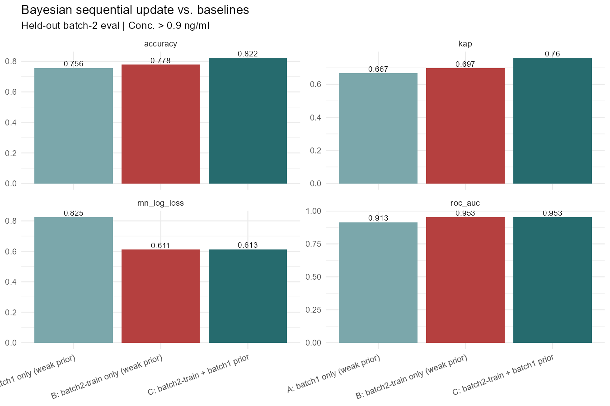

*Figure 1. Bayesian one-vs-rest performance on the held-out batch-2
evaluation slice (n = 45). Three scenarios: A — batch-1 only (weak prior);
B — batch-2 train only (weak prior); C — batch-2 train using batch-1
posterior as prior. Bars show test accuracy, kappa, log loss, and ROC AUC.
The sequential update (C) leads on accuracy and kappa while matching B on
calibration metrics — the prior helps at the argmax boundary, where
calibration is already adequate.*

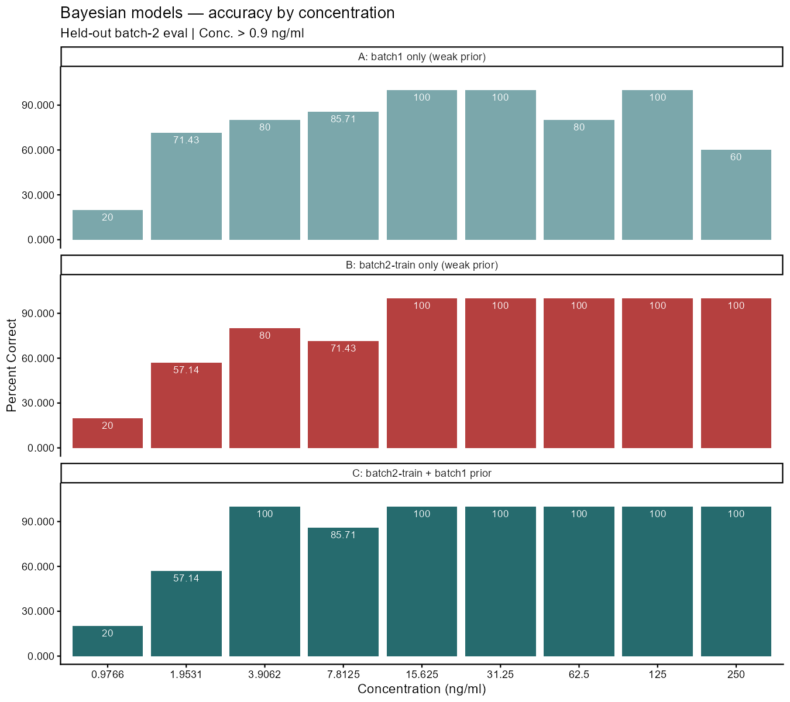

*Figure 2. Per-concentration accuracy on the held-out batch-2 evaluation
slice, faceted by Bayesian scenario. The sequential update (C) outperforms
both single-batch fits in the mid-concentration range (3.91–7.81 ng/ml)
where the variant decision boundary is noisiest; all three scenarios
converge at the high-conc plateau and at the noise-floor low end.*

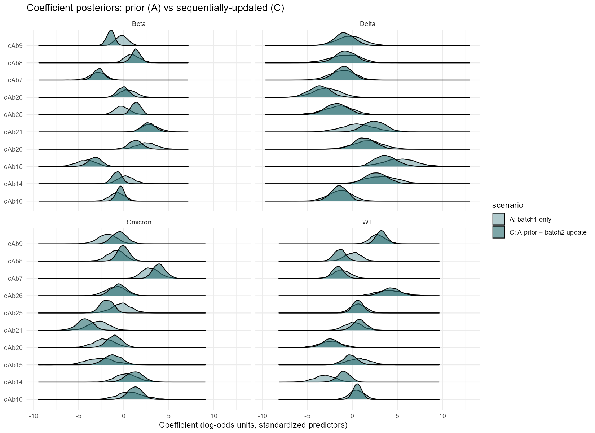

*Figure 3. Posterior coefficient distributions per cAb feature, comparing
the batch-1-only baseline (light) to the sequentially-updated model (dark),
faceted by variant class. Wider separation indicates features whose
contribution shifts most between the two batches.*

# Phase 2b — Original screen as prior

The phase-2 setup above used batch 1 as the prior and batch 2 as the update.
That's a useful diagnostic but doesn't match the field-deployment story
exactly: in the real workflow, the **deployable** model is trained on the
**original screen** (the same data driving LASSO/RF feature selection in
[Embedded_FS/](../Embedded_FS/)), and the new experimental rounds (batch 1 and
batch 2 of the augmented data) are the field feedback we'd use to update it.

Implementation in [run_v3_bayes_orig_prior.R](run_v3_bayes_orig_prior.R).
Key differences from phase 2:

- Prior data is the dAb13 panel of `data/covid_screen_data_cleaned.csv` (10
  cAbs after removing the self-pair), aligned to the augmented column names.
- Predictors are standardized to **original-data** mean/sd, so the prior scale
  on the Normal(μ, σ) priors is meaningful and consistent across all fits.
- Eval slice is a 20% holdout from each batch combined (n = 59), shared across
  all scenarios.
- Five scenarios:
    - **O**: original-only with weak priors (the deployable starting model)
    - **O+1**: O posterior as prior, updated on batch-1 train
    - **O+2**: O posterior as prior, updated on batch-2 train
    - **O+B**: O posterior as prior, updated on batch-1 + batch-2 train
    - **W+B**: weak prior, fit on batch-1 + batch-2 train (control)

```bash
Rscript augmented_data_modeling/run_v3_bayes_orig_prior.R
```

## Results (Conc. > 0.9 ng/ml)

| Scenario | Accuracy | Kappa | Log loss | ROC AUC |
|----------|----------|-------|----------|---------|
| O — original only (weak prior) | **0.186** | **−0.078** | 1.70 | 0.494 |
| O+1 — O prior + batch 1 | 0.729 | 0.639 | 0.806 | 0.927 |
| **O+2 — O prior + batch 2** | **0.864** | **0.818** | 0.579 | 0.946 |
| O+B — O prior + both batches | 0.814 | 0.750 | 0.553 | 0.952 |
| W+B — weak prior + both batches | 0.814 | 0.750 | 0.592 | 0.947 |

Two findings worth flagging:

1. **The original-only model is at chance on the augmented data** (κ ≈ 0,
   ROC AUC ≈ 0.5). This is the most important result in the file: there is
   substantial batch shift between the original screen and the augmented
   rounds, large enough that the "deployable" model trained on the original
   data alone does not transfer. Any single-batch update recovers most of
   the lost performance, which is exactly the in-field-feedback story the
   Bayesian update was meant to test — and a strong argument for that
   feedback loop being part of the deployment plan, not optional.
2. **The original prior contributes ~zero on top of having both batches**
   (O+B and W+B tie at 0.81 / 0.75). When enough field data has accumulated,
   the prior is overwhelmed; this is correct Bayesian behavior. The prior
   only matters in the small-data regime, which is the regime we'd actually
   be in at deployment time before much field data has come in.
3. O+2 alone (0.864) beats O+B (0.814), suggesting batch 1 carries its own
   drift relative to batch 2 — adding it as additional update data slightly
   hurts.

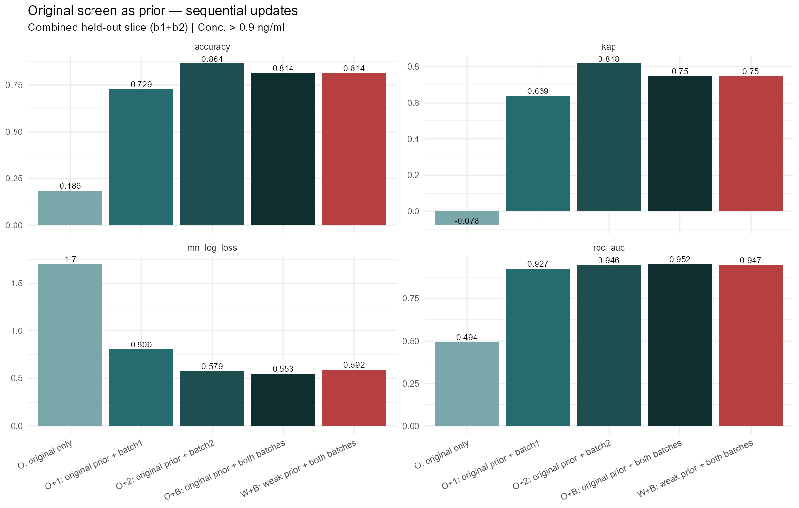

*Figure 4. Bayesian model comparison using the original screen as prior.
Five scenarios evaluated on a combined held-out slice (20% from each batch,
n = 59). The original-screen-only model (O) performs at chance
(κ ≈ 0, ROC AUC ≈ 0.5), revealing substantial batch shift between the
original screening assay and the augmented experimental rounds. Any
single-batch update recovers most of the lost performance; the original
prior contributes ~zero on top of having both batches (O+B = W+B), which
is correct Bayesian behavior in the data-rich regime.*

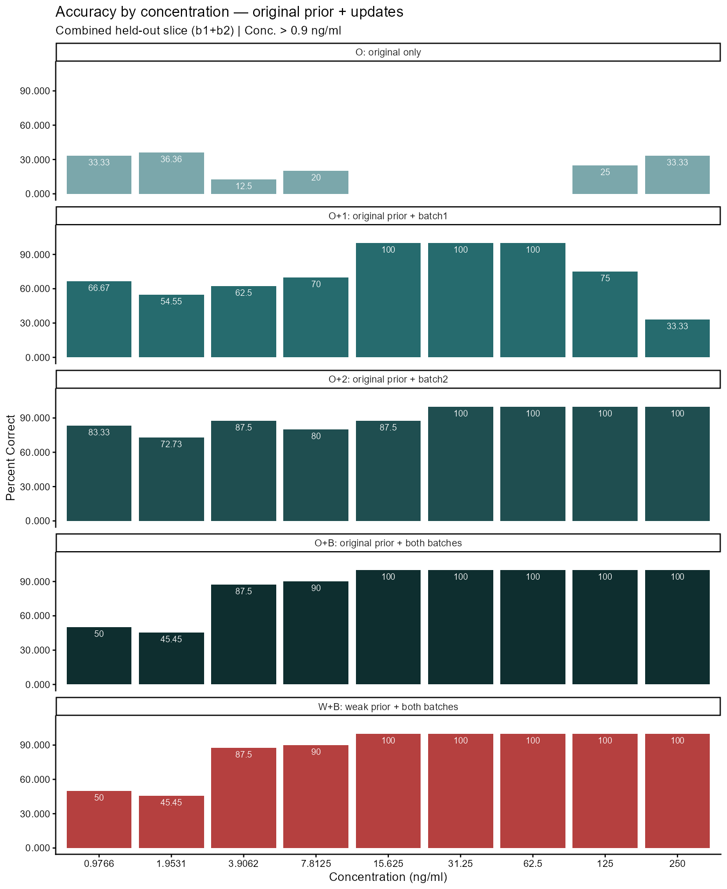

*Figure 5. Per-concentration accuracy by scenario for the original-prior
Bayesian comparison. The original-only model fails uniformly across
concentrations, while updated models recover the expected dose-response
plateau, with O+2 achieving the highest mid-range accuracy.*

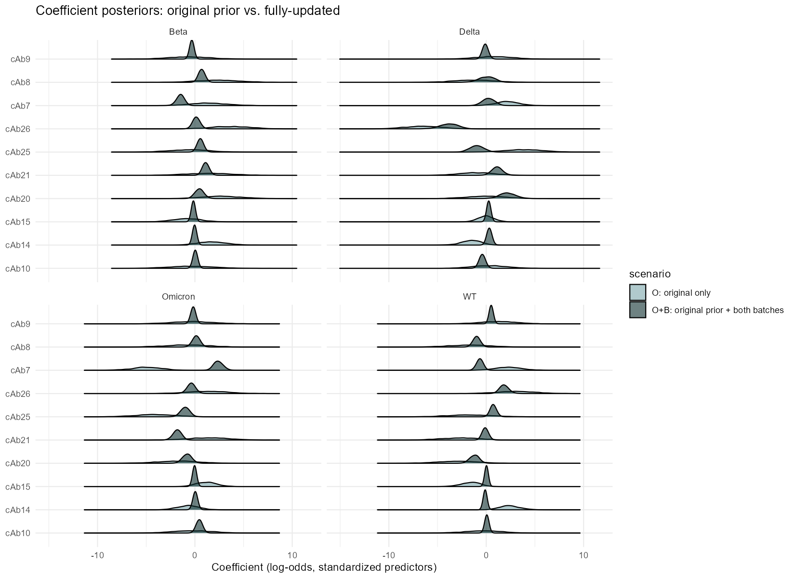

*Figure 6. Coefficient posteriors comparing the original-screen-only
model (light) to the fully-updated model (O+B, dark), faceted by variant
class. Large coefficient shifts highlight which cAb features carry
incompatible signal between the screening and final assay formats — these
are the features primarily responsible for the chance-level transfer
performance.*

Outputs land in [v3_outputs_orig_prior/](v3_outputs_orig_prior/) — kept
separate from `v3_outputs/` so the two phase-2 framings don't get mixed.

# Phase 3 — Model comparison on combined augmented data

Four model families on the same train/test split, same recipe (modulo
normalization where the model needs it), same tuning protocol (5-fold CV,
pre-defined grid, accuracy as the selection metric). All evaluated on the
same held-out test set so metrics are directly comparable.

Implementation in [run_v3_model_comparison.R](run_v3_model_comparison.R).
Tree models (RF, XGBoost) get the `step_zv → step_impute_knn → step_smote`
recipe; scale-sensitive models (elastic net, SVM-RBF) get the same plus
`step_normalize`.

```bash
Rscript augmented_data_modeling/run_v3_model_comparison.R
```

## Results (Conc. > 0.9 ng/ml, n_test = 57)

| Model | Accuracy | Kappa | macro F1 | ROC AUC | Log loss | Best hyperparams |
|---|---|---|---|---|---|---|
| **RF** | **0.860** | **0.809** | 0.878 | **0.982** | **0.413** | mtry=3, min_n=2 |
| ElasNet | 0.860 | 0.810 | 0.867 | 0.963 | 0.491 | penalty≈5e-3, mixture=0.25 |
| SVM-RBF | 0.860 | 0.808 | 0.871 | 0.885 | 0.875 | cost=4, σ=0.05 |
| XGBoost | 0.789 | 0.714 | 0.797 | 0.966 | 0.480 | depth=2, lr=0.05, mtry=5, min_n=5 |

Three observations:

1. **RF, ElasNet, and SVM-RBF tie on accuracy at 0.86.** With ~280 training
   rows and 10 features after preprocessing, the differences between
   well-tuned models are within the noise of a single test split. Worth
   re-running this across multiple seeds if you want to call a winner.
2. **RF wins on calibration metrics** (lowest log loss, highest ROC AUC).
   The tied-accuracy story changes once you care about predicted
   probabilities — RF produces the most useful confidence scores. SVM-RBF's
   high accuracy + poor log loss/AUC is the classic SVM pattern: hard
   decisions are good, but probabilities (Platt-scaled, not native) are
   under-calibrated. If the device needs a "how sure am I?" readout for the
   user, RF is the safer pick.
3. **The elastic-net winner is ridge-leaning** (`mixture = 0.25`, light
   penalty). Pure LASSO was in the grid and didn't win, suggesting most of
   the 10 features carry signal — consistent with the FS pipeline already
   having pruned the panel down. There's not much more to drop.
4. **XGBoost trails by ~7pp accuracy.** Boosting is hungry for data, and 280
   training rows is on the small side; the extra hyperparameter surface (4
   tuned params vs 2 for the others) likely also contributes via slightly
   noisier model selection. Not worth pursuing further at this dataset size.

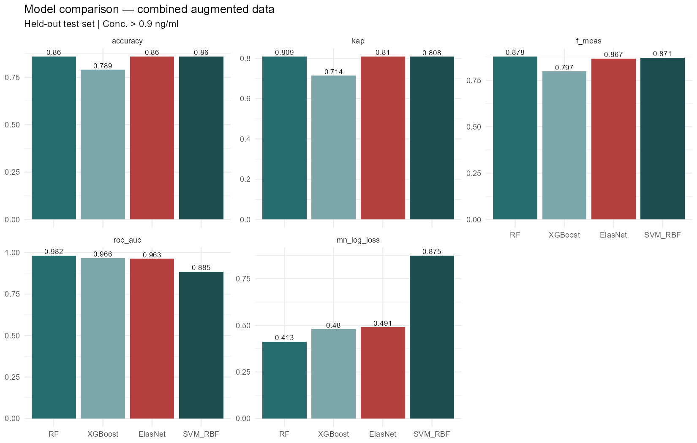

*Figure 7. Single-seed test-set performance for four model families (RF,
XGBoost, elastic net, SVM-RBF) on the combined augmented data. RF, ElasNet,
and SVM-RBF tie on accuracy at 0.86; differences emerge in calibration
metrics (log loss, ROC AUC). Single-seed results — see Phase 3b for
multi-seed uncertainty.*

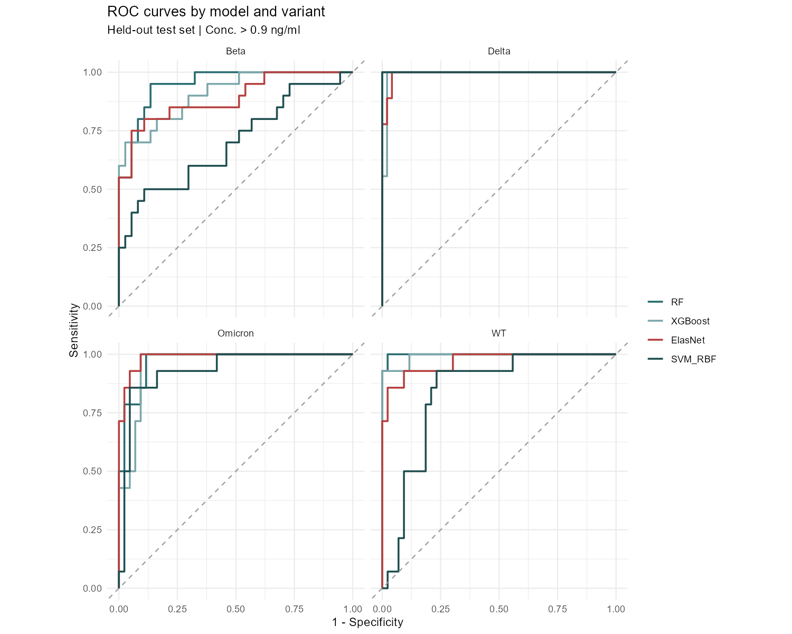

*Figure 8. One-vs-rest ROC curves by variant class for each model on the
held-out test set. The diagonal indicates chance. RF achieves the highest
area under curve across all four classes; SVM-RBF curves bow toward
diagonal, reflecting its probability-calibration weakness from Platt
scaling.*

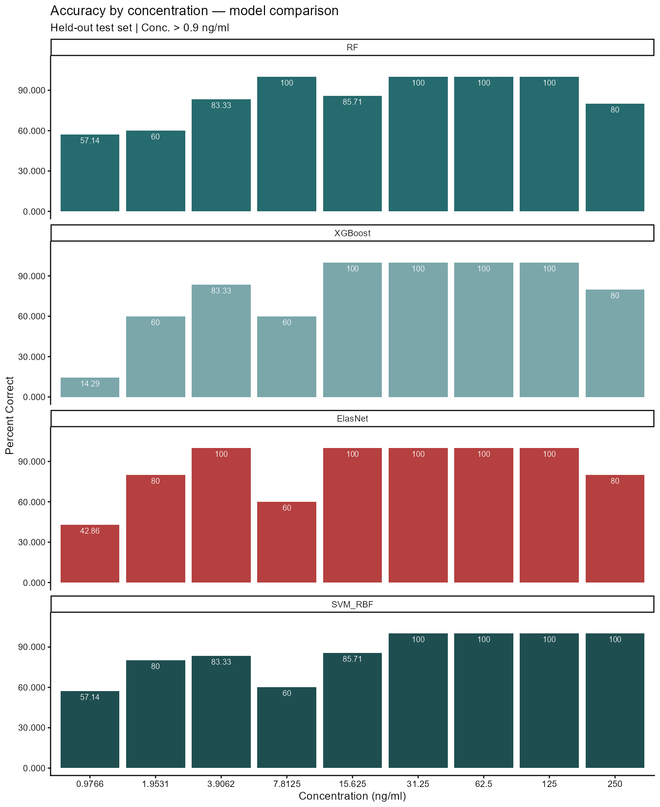

*Figure 9. Per-concentration test-set accuracy by model. All four models
plateau at ≥80% above ~7.81 ng/ml; performance degrades at the lowest
retained concentration (0.977 ng/ml), the assay's effective lower bound
for variant discrimination.*

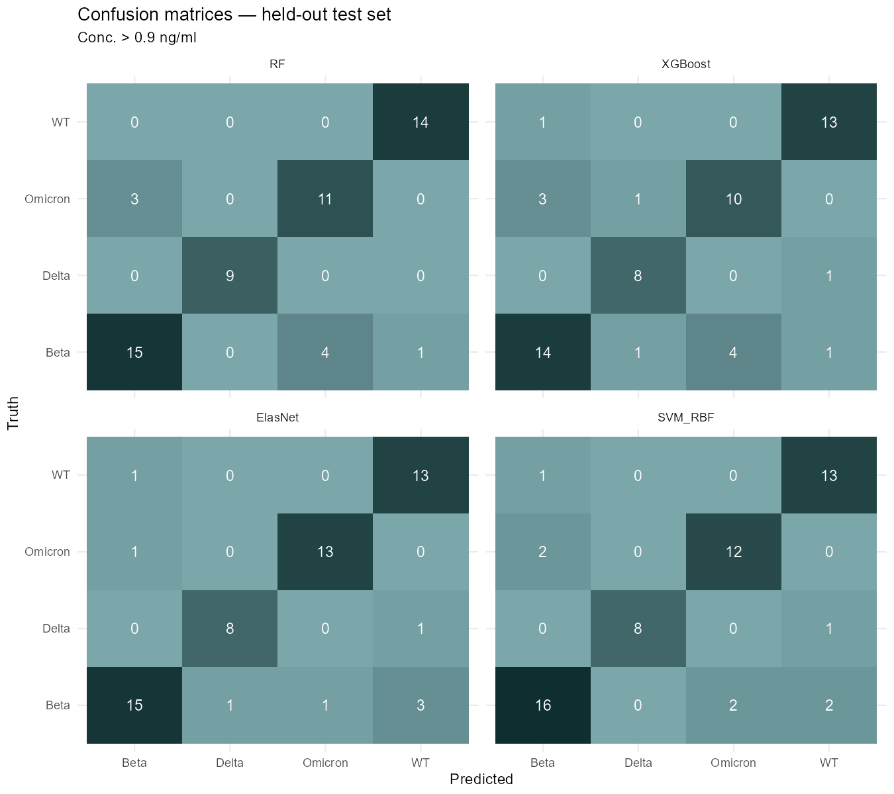

*Figure 10. Test-set confusion matrices per model. Beta and Omicron show
the most consistent confusion across model families, suggesting their
fluorescence patterns share residual similarity even after the FS-selected
feature panel is applied.*

Outputs in [v3_outputs_model_comparison/](v3_outputs_model_comparison/).

## Phase 3b — Multi-seed comparison (5 seeds)

Single-seed results suggested a 3-way tie at 0.86 accuracy. To check whether
that survives different splits, the comparison was re-run across seeds 1969,
1986, 2024, 2025, 2026, with a fresh `initial_split` and `vfold_cv` per seed
so train/test variance is included in the uncertainty (not just CV variance).

Implementation in
[run_v3_model_comparison_multiseed.R](run_v3_model_comparison_multiseed.R).

```bash
Rscript augmented_data_modeling/run_v3_model_comparison_multiseed.R
```

### Results (mean ± SE across 5 seeds)

| Model | Accuracy | Kappa | macro F1 | ROC AUC | Log loss |
|---|---|---|---|---|---|
| **RF** | **0.864 ± 0.011** | **0.812 ± 0.014** | **0.866 ± 0.017** | **0.975 ± 0.003** | 0.471 ± 0.021 |
| SVM-RBF | 0.857 ± 0.015 | 0.802 ± 0.019 | 0.856 ± 0.017 | 0.910 ± 0.015 | 0.783 ± 0.055 |
| ElasNet | 0.853 ± 0.012 | 0.798 ± 0.016 | 0.848 ± 0.016 | 0.967 ± 0.008 | 0.473 ± 0.030 |
| XGBoost | 0.843 ± 0.017 | 0.784 ± 0.022 | 0.840 ± 0.019 | 0.969 ± 0.004 | **0.421 ± 0.028** |

Findings update from the single-seed run:

1. **RF wins all four classification metrics** (accuracy, kappa, F1, ROC AUC),
   though the gaps over SVM-RBF and ElasNet (~0.5–1pp accuracy) are within
   1 SE — the rank is consistent but the differences are small.
2. **SVM-RBF's calibration weakness is durable.** Log loss 0.78 ± 0.06 is
   ~70% higher than the other three; ROC AUC 0.91 ± 0.02 trails by ~6pp.
   Confirms the Platt-scaling artifact noted in the single-seed run, with a
   real SE behind it now.
3. **XGBoost wins log loss** (0.421 ± 0.028) despite being lowest on
   accuracy. Trees are deeper-calibrated than the linear model (ElasNet) and
   shallower-calibrated than RF wins on AUC. This is a standard pattern —
   boosting yields well-calibrated probabilities even when individual
   decisions are slightly off.
4. **Per-seed scatter** (see `per_seed_scatter.png`) shows no model is
   pathologically unstable; SE is dominated by genuine train/test variance,
   not outlier seeds.

For the deployment decision: **RF remains the recommendation** — best on the
metrics that matter most for this device (accuracy + AUC, with the second-best
log loss). XGBoost is the runner-up if you specifically need well-calibrated
probabilities and can tolerate ~2pp lower accuracy. SVM-RBF is competitive on
hard decisions but its probabilities aren't trustworthy.

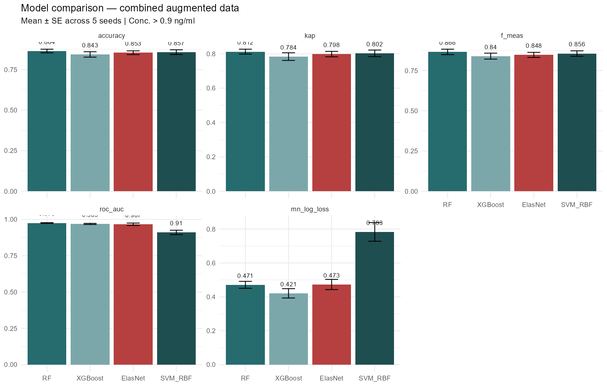

*Figure 11. Test-set performance metrics aggregated across 5 seeds (1969,
1986, 2024, 2025, 2026), shown as mean ± standard error. RF wins on
accuracy, kappa, F1, and ROC AUC; XGBoost achieves the lowest log loss;
SVM-RBF's calibration weakness (high log loss, lower AUC) is consistent
across seeds. Error bars capture train/test variance, not just CV
variance — a fresh `initial_split` is drawn per seed.*

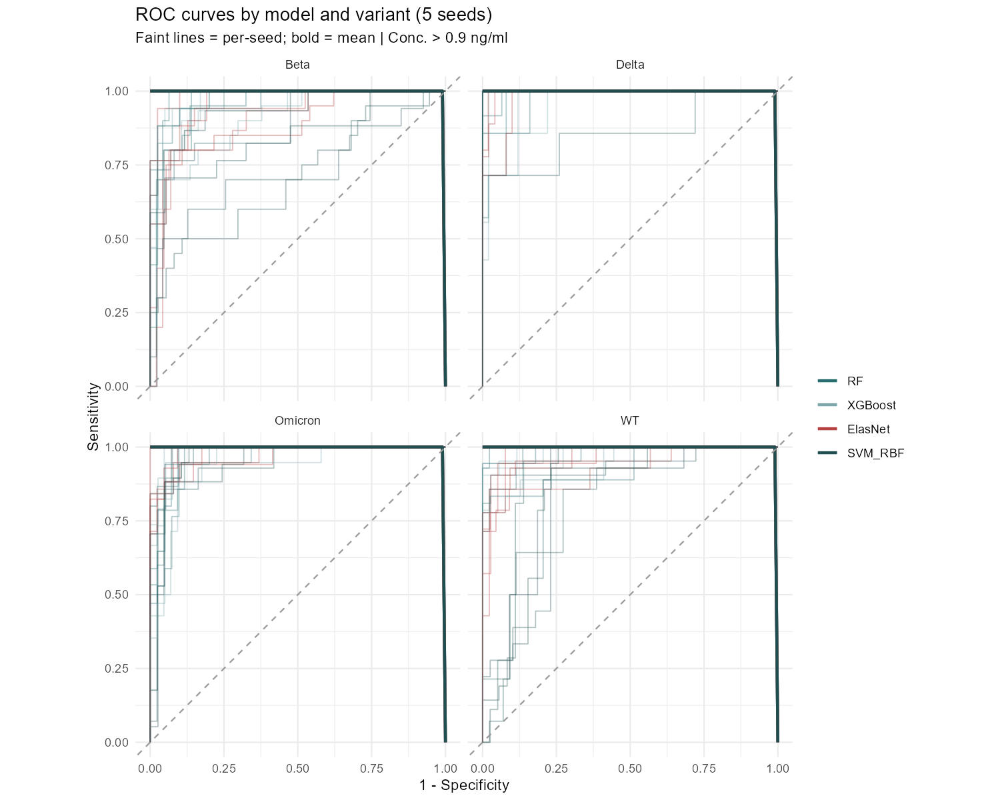

*Figure 12. Per-seed ROC curves (faint) overlaid with per-model averages
(bold), faceted by variant class. The narrow per-seed spread for RF and
XGBoost confirms stable ranking across train/test splits; SVM-RBF shows
the widest per-seed spread, particularly at the high-FPR end.*

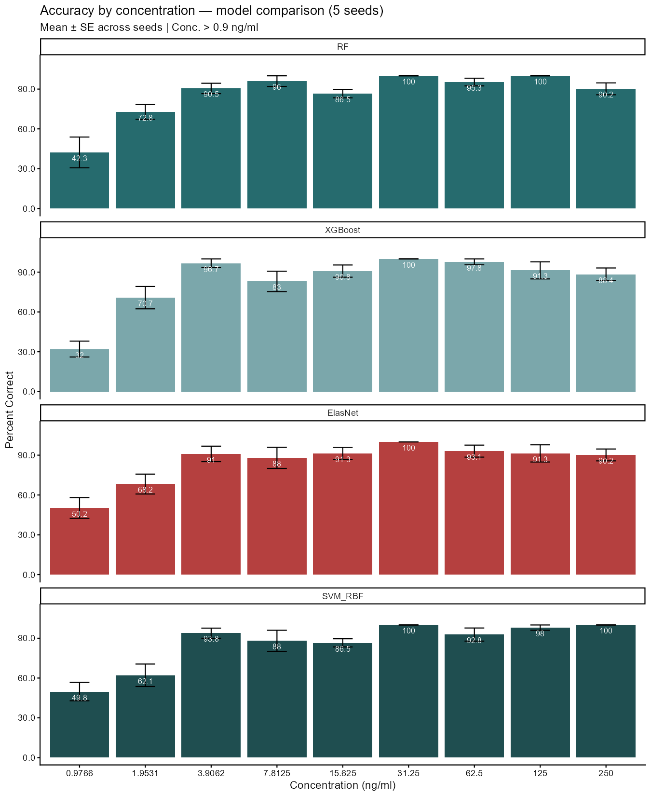

*Figure 13. Per-concentration accuracy aggregated across 5 seeds, shown
as mean ± SE per model. All four models reach 100% at ≥15.6 ng/ml; the
performance break occurs near 1.95 ng/ml, the device's effective lower
bound for confident variant discrimination.*

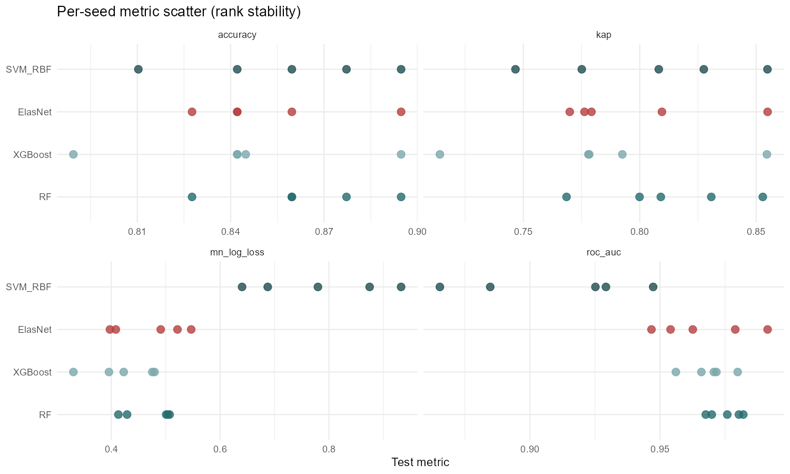

*Figure 14. Per-seed scatter of accuracy, kappa, ROC AUC, and log loss by
model. Tight horizontal clustering indicates stable performance across
splits; wide spread indicates noisy single-seed estimates. RF and XGBoost
cluster tighter than ElasNet and SVM-RBF — and no model shows a
pathological seed driving the SE.*

Outputs in
[v3_outputs_model_comparison_multiseed/](v3_outputs_model_comparison_multiseed/).
